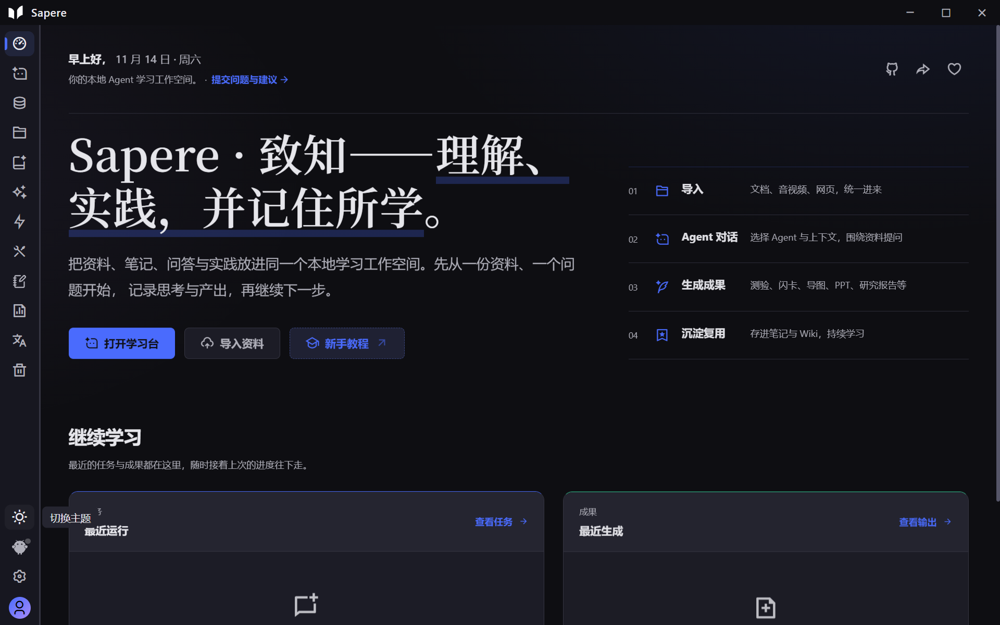
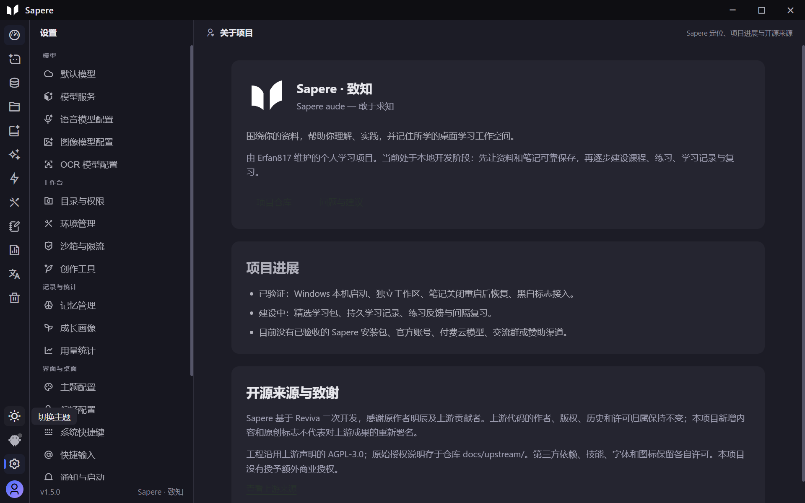

<div align="center">


# Sapere · 致知

**Understand, practice, and remember what you learn.**

A desktop workspace for continuous learning around your own materials.

Local-first · Bring your own models · Materials and notes · Continuous learning

[中文](README.md) · [Getting started](#getting-started) · [Development status](#development-status) · [Issues](https://github.com/Erfan817/Sapere/issues)

</div>

---

## Why Sapere

Self-study often stops at “I have read it.” Tutorials pile up, ideas seem clear, and a few days later it is hard to pick up where you left off.

Sapere aims to connect reading, questions, notes, practice and review in one local-first desktop workspace. The goal is a learning process you can return to, with records of what you understood, tried and need to revisit.

**Sapere aude — dare to know.** The Chinese name is 致知. Our monochrome open-page symbol represents turning another page toward the unknown.

The first planned learning package is **From LLMs to Your First Agent**, for technical learners with basic programming knowledge. Course organization, exercise records and spaced repetition are planned work, not completed features.

## Preview

These screenshots are from the actual Windows development build. They show the current interface, not a guarantee that every feature has passed acceptance testing.



<details>
<summary>Project page and identity</summary>



See the [logo kit](docs/brand/sapere-logo-kit/README.md) for vector files, icons and usage guidance.

</details>

## Development status

Sapere is in **M0: engineering and desktop foundations**. Windows 11 x64 is the first acceptance platform.

| Area | Status |
| --- | --- |
| Engineering | Git baseline, pinned toolchain, local build and desktop startup verified |
| Workspaces and notes | Isolated workspace and Chinese Markdown note persistence verified across normal restarts |
| Identity | Monochrome logo integrated; main product pages, help and exports rebranded |
| Materials, Q&A and creation | Local TXT/Markdown import, reading and restart recovery validated; Q&A and other formats still under validation |
| Courses and exercises | Planned learning packages, chapter reading and exercise submission |
| Learning records and review | Planned persistent records, due queue and spaced repetition |
| Distribution | No validated Sapere installer; automatic updates disabled |
| Other platforms | macOS and Linux not yet validated |

The first-release goal is:

**Choose a learning package → read and ask → submit an exercise → save progress → review → restart and continue.**

See the [project brief](docs/Sapere_致知_项目立项书_v0.2_Reviva二开版.md), [persistence acceptance record](docs/M0_工作区与重启持久化验收.md), [local import acceptance record](docs/M0_本地资料导入验收.md) and [M0 acceptance matrix](docs/M0_功能验收矩阵.md) for scope and evidence.

## Getting started

Run from source. Windows 11 x64 is the currently verified development environment.

Requirements: Node.js **24.16.x** (see [.node-version](.node-version)), pnpm **10.34.9** through Corepack, Git, and platform build tools if native dependencies need compilation.

Current development is on `chore/m0-startup`; use `main` once it has been merged.

```bash
git clone --branch chore/m0-startup https://github.com/Erfan817/Sapere.git
```

```bash
cd Sapere
```

```bash
corepack pnpm install --frozen-lockfile
```

```bash
corepack pnpm dev --host 127.0.0.1 --strictPort
```

This starts Vite and an Electron window. Opening the Vite URL in a browser does not provide the desktop IPC APIs.

Build without producing an installer:

```bash
corepack pnpm run build:electron
```

Follow the in-app setup guide to select an authorized workspace, then configure your own model provider or local model when needed. Development configuration defaults to the ignored `.sapere/dev-user-data` directory. Keep native SQLite modules compatible with the Electron ABI. See the [development record](docs/M0_仓库与版本管理.md) for environment details and troubleshooting.

## Your data and model choices

Files, notes and workspace data are local-first. Cloud models, OCR, speech, search and remote tools may send relevant content to the providers you configure. Local-first does not mean every capability is offline.

Sapere does not operate an official account, subscription, credits or hosted model service. Provider credentials, costs and data policies depend on your choices. Back up both the database and workspace files; the database alone does not contain all note content.

## Technology

Electron · Vue 3 · Vite · Pinia · Naive UI · UnoCSS · SQLite / better-sqlite3 · pnpm · electron-builder

Validation uses Node tests and Playwright Electron desktop checks. Runtime upgrades and installer acceptance remain staged work.

## Project resources

- [Project scope](docs/Sapere_致知_项目立项书_v0.2_Reviva二开版.md)
- [Development and version management](docs/M0_仓库与版本管理.md)
- [Workspace and note persistence](docs/M0_工作区与重启持久化验收.md)
- [Brand assets](docs/brand/sapere-logo-kit/README.md)
- [Brand integration record](docs/brand/全项目品牌替换.md)
- [Issues and suggestions](https://github.com/Erfan817/Sapere/issues)

Maintained by [Erfan817](https://github.com/Erfan817), initially for personal self-study. Include your environment, reproduction steps and actual results when reporting a problem. Do not attach credentials or private learning materials.

## Attribution and licensing

Sapere is derived from [Reviva](https://github.com/mingchen666/Reviva). We thank the upstream authors and contributors for the desktop workspace, document and note management, Agent / Skills and related foundations. Upstream history and authorship are retained while Sapere develops its own learning workflow and identity.

The project retains the upstream **AGPL-3.0** declaration in `package.json`. Original license and commercial-use statements are archived in the [Chinese upstream README](docs/upstream/Reviva-README.md#开源协议与商业授权) and [English upstream README](docs/upstream/Reviva-README_EN.md). This project grants no additional commercial rights. Third-party code, skills, fonts and icons retain their respective rights and licenses.
