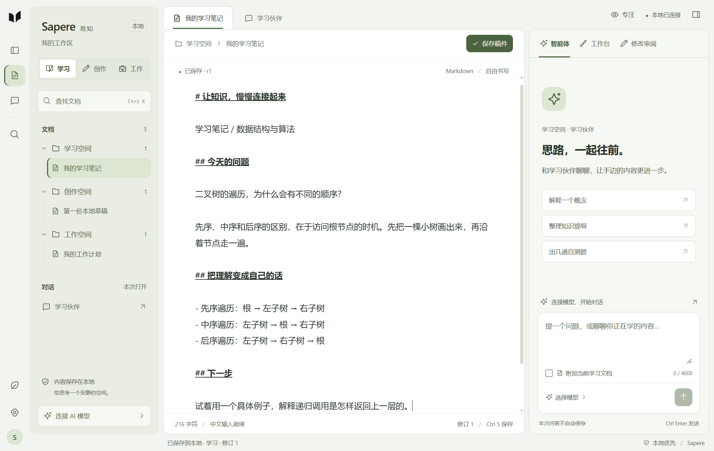
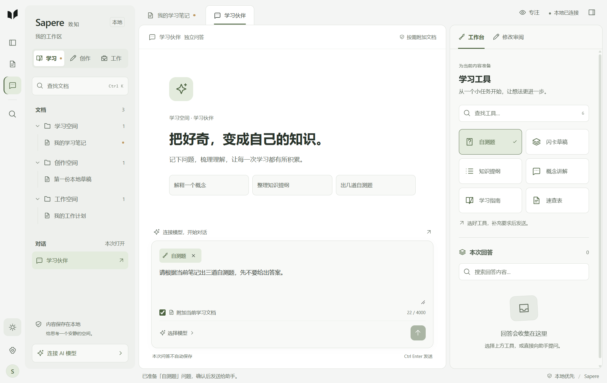
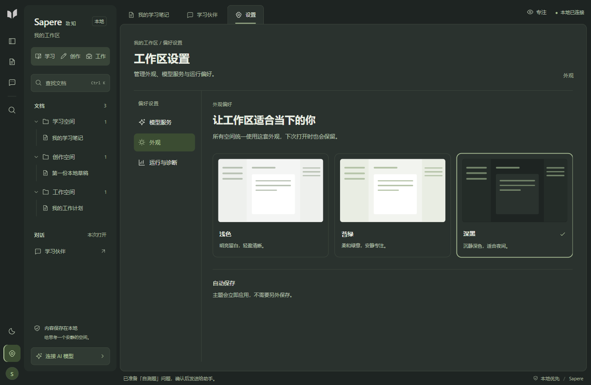
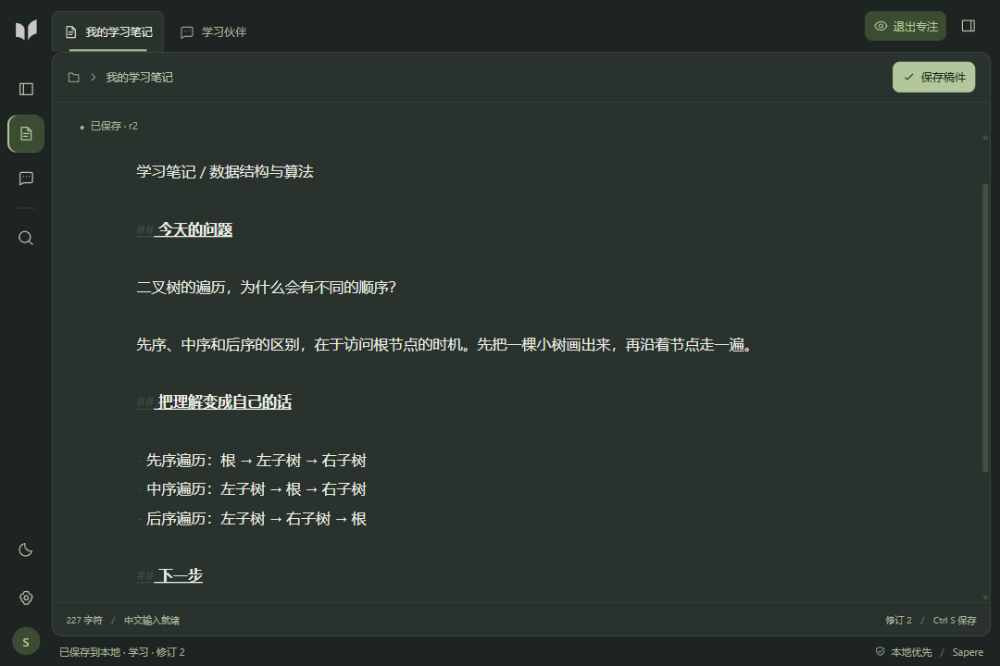

# Stitch 技能流程：整体 UI 与交互优化

日期：2026-11-17。实际项目：`<项目目录>`。

## 使用的插件与实际边界

本轮按用户指定，读取并采用三个插件中适用的技能：

| 插件 | 使用的技能与用途 |
| --- | --- |
| Stitch Utilities | `taste-design`、`enhance-prompt`：约束视觉密度、单一强调色、文字层级、组件状态，整理多页面简报 |
| Stitch Design | `extract-design-md`：分析 React 和 CSS 变量，产出带 YAML 颜色映射的 `.stitch/DESIGN.md` |
| Stitch Build | `shadcn-ui` 的可访问交互、主题和组件所有权原则；React/Vite 组件拆分原则：共享 Tabs、EmptyState、ToolWorkbench 和布局 hook |

通过工具发现两次搜索 Stitch，均没有可调用的 Stitch MCP。远端 `generate-design` 和 `react-components` 的屏幕下载流程因此不具备执行条件，本轮没有创建远端项目、生成远端屏幕或宣称已同步。使用本地技能进行源码和实际界面优化。现有 React/CSS 项目沿用本地组件与变量，不为此次优化迁移到 Tailwind 或安装 shadcn 依赖。

访问官方 prompting 文档地址返回 200，但得到应用壳，未将其当成已读到完整指南。页面简报依照插件内置规则完成，保存在 `.stitch/prompts/workspace-refinement.md`，后续可在远端设计系统建立后使用。

## 已落地

- 统一三套主题的字体、文字对比度、边框、间距和苔绿交互色，工具改为紧凑的图标文字按钮。
- 文档、对话、设置和模型弹窗沿用相同视觉规范；欢迎区左对齐，短窗口改为紧凑布局。
- 文件夹支持展开／收起，查找时展开匹配结果；品牌按钮返回工作区；图标入口提供可访问名称与 title。
- 顶部与右侧使用共享 Tabs，支持方向键、Home、End 和当前项焦点。
- 工具支持搜索、明确的选中状态与输入区标签；选中后聚焦输入。取消工具选择保留用户输入。
- Ctrl Enter 发送，组合输入时不通过此快捷键发送；生成过程可停止。回答跟随新增内容，向上滚动时保留阅读位置。
- 右侧摘要提供查看完整回答入口；修改审阅显示步骤、原文与修改后内容，对话视图可返回文档选区。
- 专注模式：Ctrl Shift F 临时收起左右面板，Escape 恢复此前布局。
- 两侧宽度与开关保存到 localStorage，重启恢复；双击分隔条恢复默认尺寸，保留键盘与拖动操作。
- 模型弹窗 Escape 关闭后恢复触发按钮焦点，主题预览同时表现导航、正文与辅助区。
- 编辑器观察容器尺寸变化并重新测量，视图和专注模式切换时保留现有内容与编辑器实例。
- 增加减少动效和强制高对比模式处理；不加载远程图标或字体。

## 验证记录

最终 `pnpm verify` 通过：类型检查、Prettier 格式、16/16 单元测试、开发态构建与 5/5 真实 Electron 桌面测试，桌面测试用时 35.1 秒，无失败、跳过或 flaky。默认沙箱启用，不调用远端模型；HTTP/SSE 夹具覆盖真实请求链路。所有测试工作区、临时文件和截图保存在项目内部。

最终桌面汇总：`.sapere/verification/playwright-results.json`；布局与新交互：`.sapere/verification/layout-0iiMn6/`；审阅与持久化：`.sapere/verification/desktop-eZu9n6/`；独立空间、模型与主题：`.sapere/verification/experience-cvQ6IX/`。精选截图复制到本目录的 `stitch-ui/`，包含 1080 × 720 两视图、设置、弹窗和专注模式。

桌面回归新增检查专注模式与 Escape、布局重启恢复、文件夹折叠、工具搜索与选中、输入聚焦、取消选择保留文字、键盘页签、Ctrl Enter 实际请求、回答详情、模型弹窗恢复焦点以及紧凑布局。三主题的主文字／正文、次文字／导航、辅助文字／导航、主按钮文字／底色检查对比度至少 4.5:1；这是指定颜色组合检查，不代表完整 WCAG 或屏幕阅读器认证。

## 实际应用截图

以下正文为隔离测试工作区中的样例。均由真实 Electron 应用截图取得。

## 范围

文档、修订、模型凭据、请求隔离和退出保存沿用现有机制。问答仍为单次调用，每个空间只有一份正式文档，工具生成的文字不自动成为持久化成果。真人 IME、屏幕阅读器及干净机安装仍需单独验收。

## Windows 安装版

`pnpm dist` 已将本轮 UI 打入 Sapere 0.1.0-alpha.1 Windows x64 安装包（本地归档）。安装包为 134,316,225 字节，未签名。SHA256 见校验文件（本地归档）。

从安装包提取的 `Sapere.exe` 和 `resources/app.asar` 与打包输出的 SHA256 一致。使用实际包内程序运行 `pnpm test:e2e`，默认沙箱下 5/5 通过，耗时 25.7 秒。证据位于 `.sapere/verification/release-0.1.0-alpha.1/`。安装器的交互安装、覆盖安装与卸载流程待人工验收。
