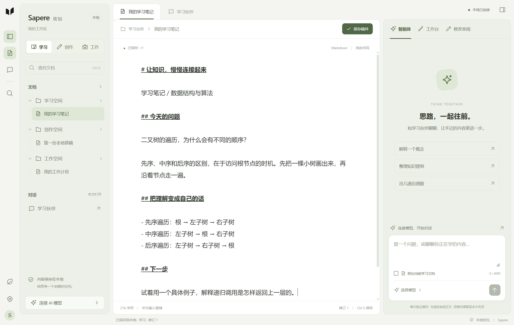
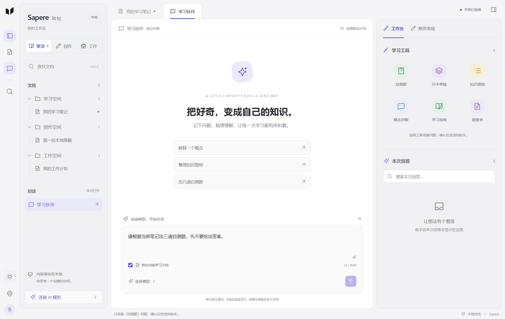
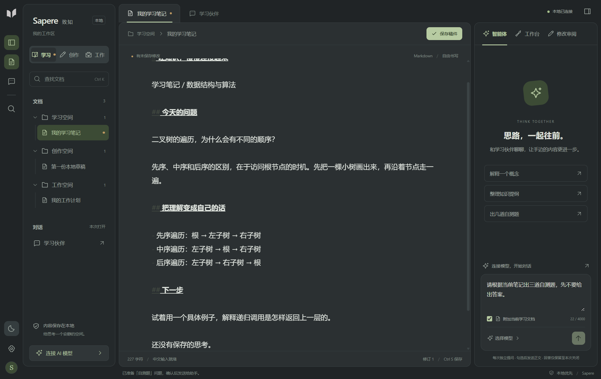

# 三栏 UI 与文档／对话双视图

日期：2026-11-17。项目目录 `<项目目录>`。

本文记录首轮三栏布局。后续整体视觉、专注模式、布局持久化与可访问交互更新见 [Stitch UI 优化记录](stitch-ui-refinement.md)；本文测试目录与截图保留为首轮证据，最新样式见后续记录。

## 完成内容

参考用户提供的两张截图，重写应用主布局和样式。采用窄快捷栏、左侧资源导航、中间主工作区与右侧辅助面板；顶部文档／助手标签切换视图，移除正文上方的大块欢迎标题和常驻运行指标。

当前目标设计规则、尺寸、场景与后续页面见 [UI 布局与交互设计 v2](../planning-v2/05-UI布局与交互设计.md)；本文记录的是当前已实现状态。

- 文档视图：连续 Markdown 编辑区，右侧智能体、工作台和修改审阅；助手输入固定在底部。
- 对话视图：中间问题和流式回答，右侧六个场景问题工具及本次回答摘要；可筛选摘要。
- 资源导航：三个现有空间的文档树、文档查找、当前场景对话、模型设置入口。
- 左右面板：独立收起，鼠标拖动、方向键和 Home / End 调整宽度；Ctrl K 查找、Ctrl S 保存。
- 三套主题：苔绿、浅色与深黑；沿用持久化主题选择。使用本地 SVG 线性图标。
- 现有未保存状态、正文、助手请求和回答在视图切换时保留；现有退出保护、审阅和模型配置继续工作。

## 修改文件

| 文件 | 用途 |
| --- | --- |
| `apps/desktop/src/renderer/App.tsx` | 应用外壳、资源树、顶部标签、导航查找、面板开关、设置入口 |
| `apps/desktop/src/renderer/SpaceEditor.tsx` | 双视图、场景工具、助手输入与回答、审阅、保存快捷键 |
| `apps/desktop/src/renderer/workspace.ts` | 场景工具与提示词配置 |
| `apps/desktop/src/renderer/Icon.tsx` | 本地 SVG 图标 |
| `apps/desktop/src/renderer/ResizeHandle.tsx` | 鼠标与键盘分隔条 |
| `apps/desktop/src/renderer/style.css` | 整体布局、三套主题、紧凑窗口适配 |
| `tests/e2e/desktop.spec.ts` | 沿用四项业务桌面回归并增加布局交互验证 |

## 验证

运行环境和产物目录沿用 `scripts/project-shell.ps1`，所有测试数据、截图和临时数据均在项目 `.sapere/` 中。桌面验证使用真实 Electron 与默认沙箱；模型 transport 使用本地 HTTP/SSE 夹具，无远端调用。

`pnpm verify` 全部通过：

- `pnpm typecheck`：通过。
- `pnpm format:check`：通过。
- `pnpm test:unit`：16/16 通过。
- `pnpm build`：通过，开发态 `out/` 已更新。
- `pnpm test:e2e`：5/5 通过，用时 28.5 秒，无失败、跳过或 flaky。

最终汇总为 `.sapere/verification/playwright-results.json`。新增布局证据保存在 `.sapere/verification/layout-2BrQl3/`，报告 `errors: []`；独立空间、主题和本地流式调用证据在 `.sapere/verification/experience-epInNo/`。用于本文的截图已复制到 `docs-sapere/implementation/ui-layout/`，便于直接查阅。

桌面回归覆盖：三个空间保存和切换、未保存退出和失败保留、审阅接受／拒绝／过期、进程失败重连和检查点重启恢复、三主题、加密配置与恢复、本地流式请求。新增验证覆盖文档／对话切换保持未保存正文、工具填入问题、模型未配置时发送禁用、回答在两视图间保持和筛选、收起导航后快捷键查找、空搜索结果、左右面板开关、键盘及鼠标调整、1080 × 720 两视图显示和正文换行实际入库。

## 实际界面

以下截图来自隔离测试工作区，正文为测试样例。

## 范围

工具是准备问题的快捷入口，生成文字由现有模型连接处理；每个空间一份文档、每次一个独立问题，回答不自动保存、不自动应用到正文。右侧摘要不代表成果数据库。没有新增多文档、持久化多轮会话、自动 Agent 编辑、PPT／播客／图谱等业务。当前修改已构建到开发态 `out/`；现有 `release/` 安装包尚未重打，不包含本轮 UI。真人 IME 和干净机安装仍需要专项验收。
