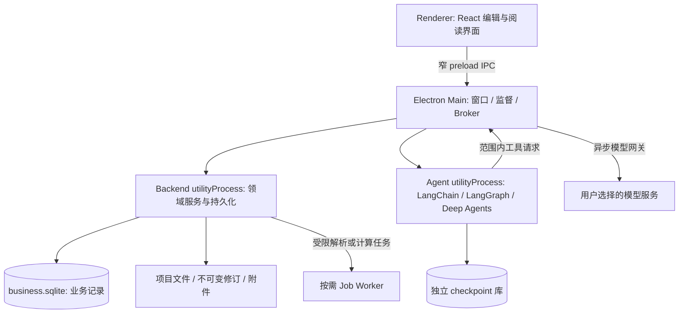

# Sapere 桌面架构与数据设计

> **已被 v2 取代（2026-11-18）：** 当前进程、安全、文件和 IPC/数据契约以 [桌面架构 v2](../planning-v2/03-桌面架构与数据设计.md) 与 [IPC 数据契约](../planning-v2/06-IPC与数据契约.md) 为准。

> 版本：v1.0 规划稿；日期：2026-11-16；作者：Monday。  
> 性质：待实施设计。当前目录只有资料，不代表以下进程、接口、数据库或安装包已经存在。  
> 2026-11-17 实施补注：原始设计保留；S0 SQLite 驱动已因 V8 编译冲突改为 `node:sqlite`，见 [ADR-001](../../docs/adr/ADR-001-S0-runtime-and-sqlite.md)。其他当前状态见 [S0 验证记录](../implementation/S0-validation.md)。
> 配套：[产品范围与验收](01-产品范围与验收.md)、[Agent 架构](02-Agent架构与技术决策.md)、[工程交付](04-里程碑与工程交付.md)。

## 1. 架构目标与范围

采用 **Electron + React + TypeScript 的模块化桌面应用**。学习、工作、创作共用项目、资料、文档、任务和版本基础，各自维护业务状态。首版单用户、单机、单个活动工作区，工作区可含多个项目；代码组织预留跨平台，首先验收 Windows 11 x64。

成熟组件承担窗口、编辑器、解析、SQLite、Agent 编排和复习算法。Sapere 应用层承担对象关系、权限、保存、业务流程、扩展入口与交付质量；不以从零实现基础库作为目标，也不以给完整产品换名称代替核心开发。

结构首先满足可维护、可恢复和可验证。它是一个产品内的职责分工，不等于部署多个服务器或建设微服务。

## 2. 进程职责与通信



| 部分 | 负责 | 约束 |
| --- | --- | --- |
| Renderer | 文件树、阅读、编辑、练习、表格预览、任务状态、审阅 | `nodeIntegration: false`、`contextIsolation: true`、启用沙箱；不读数据库，不获得 API Key |
| Preload | 显式暴露经过类型定义的操作与事件 | 不暴露任意 `ipcRenderer`、文件系统、SQL、shell 或任意方法名转发 |
| Main | 应用生命周期、原生对话框、单实例、窗口、进程监督、凭据和异步模型网关、ToolBroker 路由 | 不在主进程运行解析、大表计算或同步数据库事务；检查调用窗口和权限上下文 |
| Backend utilityProcess | 领域服务、参数/授权复核、仓储、文件提交、索引、备份、业务迁移 | 活动 `business.sqlite` 唯一写入者；完整事务在该进程内完成 |
| Agent utilityProcess | 执行图、工具调度、流式事件、上下文、运行器与 checkpoint | 通过 broker 调业务工具；不直接打开业务库或任意读写项目文件 |
| Job Worker | PDF 解析、较重的 CSV 运算等有资源预算的工作 | 按需启动或使用受控池，输入输出范围明确；首版不执行任意 shell / AI 生成代码 |

utilityProcess 提供进程隔离和独立 Node 运行环境，**不构成操作系统权限沙箱**。Agent 的工具白名单、路径检查和资源限制由应用实施；以后开放任意代码执行，应另选真正的隔离环境。

S0 先验证 Main/Backend/Agent 的进程通信、关闭和打包；重任务 worker 按数据规模加入，不提前引入网络服务、容器编排或常驻 Python 环境。

### 2.1 IPC 契约

- 使用版本化请求信封：`protocolVersion`、`requestId`、操作名、参数、超时。响应包含结果或稳定错误码、`traceId`、是否可重试。
- 客户端传入的 `projectId`、路径、权限枚举都只是待检查输入。Main 绑定活动窗口/工作区，Backend 根据真实对象归属重新判断权限。
- 请求和结果用 Zod 等 schema 校验；限制消息、附件和事件大小。大文件按文件句柄或分段协议传递，不经 IPC 一次复制整本 PDF。
- 事件至少带 `eventId`、`runId`（适用时）、单调递增序号及类型。允许断线后补取已持久化事件，不能把 UI 展示当作已保存依据。
- 高频 token 流可批量推送；重要状态和业务效果须独立持久化。UI 订阅卸载时释放监听，不因切页启动第二次执行。
- 模型和工具请求均支持取消关联。进程退出后旧请求明确失败，不把响应自动投递给新工作区。

## 3. 技术组件建议

| 层 | 初始选择 | 版本与采用原则 |
| --- | --- | --- |
| 桌面与构建 | Electron、electron-vite、electron-builder | S0 选择官方受支持版本；Windows NSIS 为首个发行目标，若发布可选便携包则单独验收 |
| UI | React、TypeScript strict、React Router、Tailwind 和可访问组件 | 主界面不出现框架名；布局、快捷键、中文与缩放按实际桌面验证 |
| 编辑 | CodeMirror 6、Markdown 预览与差异审阅 | 首版 Markdown 文件模型；WYSIWYG、BlockSuite、Kition SDK 可后续独立评估 |
| 前端状态 | Zustand 管 UI，异步查询缓存按需采用 | 业务真源在 Backend；渲染状态不充当持久化数据库 |
| 业务持久化 | SQLite、better-sqlite3、版本化 SQL 迁移；Drizzle 作为类型仓储候选 | 同步驱动放 Backend；是否引入 ORM 由实际收益决定，不维护两套 schema |
| 搜索 | 项目范围全文索引 | SQLite FTS5 的中文方案专项验证；不把默认英文式切词当中文已合格 |
| 解析 | PDF.js 文本提取/阅读、结构化 CSV 解析器、MD/TXT 导入 | 首版文字 PDF；CSV 编码、空值、数字规则有明确支持范围 |
| Agent | LangChain / LangGraph，Deep Agents 为受控长任务 profile 候选 | 以 [02 决策](02-Agent架构与技术决策.md)为准；共用运行接口，不叠加重复模型循环 |
| 复习 | ts-fsrs 的兼容稳定版本 | 状态、参数和算法版本随记录保存；新算法不静默改变历史解释 |
| 校验 / 质量 | Zod、ESLint、现有格式工具、Vitest、Playwright/Electron | 正式阶段按任务采用有价值的检查，本轮只规划不执行应用测试 |

**版本兼容是 S0 必做事项。** 本轮 npm 快照中 `ts-fsrs@6.0.0` 要求 Node `>=24`；Agent SQLite saver 依赖 `better-sqlite3` 的 12.x，而该驱动 latest 已为 13.x。不能无差别安装所有 latest，再用强制 overrides 掩盖冲突。开发机 Node 版本也不等于 Electron 内嵌 Node 版本；需核对实际进程版本、原生模块 ABI、CPU 架构和锁文件。

## 4. 应用模块与依赖方向

| 模块 | 领域所有权 | 对外提供 |
| --- | --- | --- |
| Workspace / Project | 工作区登记、项目身份、归档/回收、范围授权 | 项目生命周期与查询 |
| Source / Ingestion | 原资料、修订、解析任务、片段、引用锚点 | 导入、定位、查询上下文 |
| Document / Version | 文档正文、修订、外部冲突、快照、修改应用 | 保存、比较、接受提案、回退 |
| Learning / Review | 课程、题目修订、真实作答、提示、复习状态与日志 | 出题草稿确认、作答、复习评分 |
| Work / Analysis | CSV 数据、结构化方案、实际结果、报告 | 分析计划校验、执行、重算与导出 |
| Creation | 作品、章节顺序、设定文档与关联 | 作品组织、上下文选择、导出 |
| Run / Approval | 用户目标、执行尝试、事件、审批、效果账本、用量 | 启动、取消、恢复、审批、状态补取 |
| Artifact / Export / Backup | 产物、导出、项目逻辑快照与恢复 | 保存成果、打包、完整性验证 |
| Capability / Tool / Model | 能力声明、工具范围、模型配置与接入 | 可用能力查询、按范围执行 |

Renderer 不导入 Backend 的实现；业务模块不依赖 Electron 窗口对象；Agent 通过工具端口调用领域服务。新功能向已有模块请求操作，不直接改其他模块表或复制第二套文件写入逻辑。

## 5. 目录与仓库组织建议

以下为未来开发目录方案，不在本轮创建应用骨架，也不覆盖现有文档。

```text
Sapere/
  apps/desktop/
    src/main/             窗口、系统集成、监督与 broker
    src/preload/          显式 IPC API
    src/renderer/         React 页面与 UI 模块
  packages/contracts/     IPC、事件、对象引用及版本化 schema
  packages/domain/        领域服务、纯规则、端口
  packages/backend/       唯一业务写入、文件/索引/迁移适配
  packages/agent-runtime/ LangChain / Graph / Harness 适配
  packages/job-worker/    受限解析与结构化计算
  packages/editor/        编辑、修订、差异视图适配
  packages/capabilities/  工具、模板、学习和创作能力声明
  tests/fixtures/         来源明确的独立测试资料与结果
  docs-sapere/            本项目现有规划、调研、品牌
  docs/adr/               从开始实现起维护的技术决策
```

单仓库、统一包管理器与锁文件；只有出现清楚依赖边界时才拆 package，不把每个服务都发布 npm。应用业务为自己设计实现；依赖、借鉴、复用资产的来源分别登记，贡献描述和实际代码保持一致。

## 6. 本地数据与工作区

配置与内容分开：系统用户数据目录仅放工作区登记、UI 设置和加密凭据；首次启动由用户选择内容工作区。安装目录不存可变正文，开发/测试使用项目内隔离目录。实际目录在设置中可见。

```text
用户选择的 workspace/
  .sapere/
    workspace.json        工作区格式与 ID
    business.sqlite       Backend 独占写入
    agent/checkpoints.sqlite
    staging/              未完成导入和文件提交
    journals/             跨文件/数据库操作恢复记录
    indexes/              可重建索引
  projects/<projectId>/
    sources/<sourceId>/    原件与不可变源版本
    documents/            当前可读 Markdown 工作副本
    revisions/            不可变正文修订与内容对象
    attachments/          图像等附件
    artifacts/            实际任务输出
```

业务数据库记录对象、关系、状态、修订指针和日志；不可变源件/修订保留在文件中。当前 Markdown 文件是方便用户查看和外部编辑的工作副本，不与修订指针默默争夺真源：文件变化须经过导入或冲突协调后形成新修订。

### 6.1 核心数据实体

| 实体 | 最小关键字段 / 关系 | 不变量 |
| --- | --- | --- |
| `projects` | ID、名称、类型提示、状态、创建/打开时间 | 类型不封锁其他用途 |
| `sources` / `source_revisions` | 项目、来源、格式、哈希、修订、解析器版本 | 原件不可被 Agent 改写；引用不随更新换指向 |
| `source_segments` / `citations` | 源修订、页、文本范围、引文、校验状态 | 只有能核对的锚点显示为有效引用 |
| `documents` / `document_revisions` | 项目、当前修订、内容哈希、作者来源、保存时间 | 改写以 `baseRevision` 做并发前置条件 |
| `works` / `chapters` / `document_links` | 作品、章节文档、排序、设定与资料关联 | 排序和改名不改变章节身份 |
| `course_packages` / `units` | 包 ID、版本、哈希、单元、内容来源 | 内容与用户进度分开 |
| `exercise_revisions` | 题型、题干、答案、规则、引用、确认状态 | 作答绑定题目快照，后改题不改历史 |
| `attempts` / `learning_events` | 答案、评分方式、提示、看答案、首次/重做、时间 | 真实行为不由模型摘要补造；提交幂等 |
| `review_cards` / `review_states` / `review_logs` | 卡片内容版本、调度版本、参数、due、评分与前后状态 | 评分、状态、日志同一事务 |
| `datasets` / `analysis_specs` / `analysis_results` | CSV 源修订、字段、规则、结果、引擎版本 | 关键指标来自实际确定性计算 |
| `runs` / `execution_attempts` / `run_events` | 目标、thread、模型、状态、进程尝试、序号、错误 | UI 可从已保存事件重建；不中断就伪标完成 |
| `approvals` / `tool_effects` | scope、参数 hash、baseRevision、时效、幂等键、结果 | 授权有具体对象；重放前检查已执行效果 |
| `edit_proposals` / `artifacts` | 目标/输入修订、run、候选内容、状态、文件 | 候选稿和已应用版本分开 |
| `context_bundles` / `usage_records` | 引用范围、裁剪记录、模型、用量来源 | 不把估算当账单，不默认混入其他项目 |

字段定义、索引、枚举及引用删除策略在 S1 schema 中固定；所有表都需要明确项目归属或受控的全局归属。对外契约带 schema 版本；UUID、UTC 时间戳和 ISO 日期按用途规范化。显示与复习队列按用户时区计算，时区变化不重写原事件。

### 6.2 文件与数据库一致性

文件系统与 SQLite 无法组成同一个原生事务。通过**不可变修订 + 条件提交 + 操作记录**恢复，不能只声称“原子保存所以不会丢”。

1. Backend 校验目标、权限及 `baseRevision`，序列化该文档的提交操作。
2. 写 staging 内容，校验哈希，将新修订写入同文件系统的不可变目标；写入失败不更新当前修订。
3. 在一个业务事务里提交文档新 head、版本、事件、提案应用结果和效果幂等记录。
4. 更新可读工作副本。若发现外部编辑，保留外部内容为冲突副本；不静默覆盖。
5. 进程崩溃后根据操作阶段恢复：清理未引用孤立文件，补齐已提交的工作副本；不删除仍被历史或备份引用的内容。

任务写命令同时携带稳定 effect ID 和执行 epoch：副作用意图先保存进可恢复状态，业务提交时检查同 ID 的结果和参数，并复核取消标记。参数 hash 用于识别同一操作被更改，不单独承担去重；用户主动重复操作可创建新 ID。同 thread 仅一个活动 run，避免跨任务写入与 checkpoint 交错。

UI 的“已保存”以 Backend 返回的已提交修订为准。未保存输入继续留在编辑器，错误可见并可重试；若持久层失效，提供另存恢复稿/复制出口，不能承诺所有未确认输入一定能恢复。回退版本创建新 head，不删除后续历史。

### 6.3 数据迁移

- schema 由单写者执行版本化、可审阅的迁移，记录版本和校验信息。
- 迁移前生成可恢复快照；迁移失败保持旧工作区可找回，不在半迁移库上继续工作。
- 新应用可以迁移旧数据；旧应用遇到更高格式版本时拒绝写入并说明升级/恢复方式。
- 应用回退不等于数据库可降级：需要恢复匹配快照，或经过验证的向下迁移；数据和程序必须一并判断。

## 7. 资料、检索和引用

首版先做项目内全文检索和用户选择的资料上下文。中文检索在真实资料上比较 FTS5 trigram、字符索引与短查询回退，查询带参数和项目过滤；S0 检查 SQLite 构建是否支持所选 tokenizer。向量/图检索作为独立索引端口保留，不要求首版运行图数据库。

文本 PDF 保存页级文本与片段；片段 ID 绑定源修订和解析器版本。回答引用由应用验证 ID、引文和版本后再显示；页码有效不等于内容支持结论，内容忠实性还需样例审阅。扫描、加密、无文本文件显示清楚支持状态。

检索、摘要、裁剪和完整原文是不同对象。上下文包记录带入哪些片段、正文修订和设定；超预算给出截断/选择信息，不能把只读几页称为全书分析。重建索引不会改源件、作答或作品版本。

## 8. 三个业务域的关键实现规则

### 8.1 学习

- 课程正文、题目、用户笔记和作答各自有身份。AI 生成题目先校验结构、展示来源并由用户确认。
- 客观题走确定性规则；简答自评或 AI 评价保留评分方式，不与确定答案混算。
- 查看提示、揭示答案、首次提交、重做分别记事件；网络重试共用 `requestId`，主动重做生成新 attempt。
- 复习状态由调度服务负责；评分时使用记录的卡片版本、算法版本与参数，日志和状态一次提交。源失效保留卡并标注。
- v0.1 不声称“算法已精确测出掌握度”，只展示可解释记录和建议；更复杂学情模型留在扩展端口。

### 8.2 工作

- 原 CSV 只读持有，预览分页/虚拟化。导入时明确编码、分隔符、类型、空值和日期规则；大文件先给进度或拒绝超出上限。
- 分析使用结构化白名单操作，例如筛选、分组、计数、求和、均值。模型可建议参数，执行器验证列名/类型/范围后计算。
- 默认不执行模型自由生成的 JavaScript、Python 或 shell。后续需要自由分析时通过专门沙箱扩展，保持同一输入/结果/版本契约。
- 数值精度、舍入、缺失值和时区规则属于 `analysisSpec`；报告数字指向实际结果，不用模型心算代替计算。
- 导出记录数据哈希、分析配置和引擎版本；重新执行可对照。CSV 公式样文本的导出转义策略明确展示，不改变内部原始数据。

### 8.3 创作

- 单篇沿用单章模型；作品目录管理排序、设定、素材，正文依旧由 Document 服务保存。
- 用户显式选择当前段/章、相邻内容、人物/设定与来源资料；人物卡摘要不能冒充完整前文章节。
- AI 提案记录目标、`baseRevision`、变更和来源；接受时重新检查版本。拒绝不写正式稿，部分接受创建对应的新修订。
- 运行策略支持只建议、逐项审阅、授权范围自动应用并留快照。v0.1 默认审阅；自动应用只覆盖用户为一次任务明确指定的目标和操作，通用批量自动化以后按能力逐项增加。
- 外部编辑、中文输入组合、其他运行产生的修改均可能让提案过期；显示冲突、刷新或重新生成，不强行覆盖。

## 9. 模型、文件与权限

- 主进程 Vault 通过系统保护方案存 Key。优先考虑选定 Electron 的非阻塞 safeStorage API，核对 Windows DPAPI 等实际语义；它不保证抵抗已控制当前用户会话的恶意程序。
- 子进程使用明确的环境变量白名单，避免默认继承 `*_API_KEY` 等秘密。Renderer 和普通业务日志不获得明文。
- 模型网关基于 `runId`、选定 provider 与能力配置发起异步请求；子 Agent 不能把凭据带到任意地址。
- 云模型、OCR、语音、搜索和外部工具的数据去向按实际操作呈现；无 Key 的连接错误不阻塞本地阅读/编辑。
- 文件工具接受稳定对象 ID，Backend 解析到本项目路径；校验绝对路径、根目录、软链接/junction 等，不能只做字符串前缀检查。
- 外部正文和工具结果属于数据，不能仅凭其中的提示就扩大权限或改变目标。审批绑定对象版本、参数、范围与有效期。
- Markdown/HTML 预览清理危险内容，默认不执行脚本、不自动加载远程图片；需要交互网页时使用单独隔离的预览能力。

## 10. 导出、备份和恢复

### 10.1 项目包结构

建议项目包由 manifest、版本化业务记录、源件、文档修订、附件和产物组成；每个文件有哈希与逻辑路径。包格式版本与应用版本分开。

**排除：** Provider 凭据、账号/OAuth、浏览器状态、其他项目、全局配置、完整原始请求、checkpoint 和可重建索引。运行记录可以保留必要的项目目标、输入引用、产物和脱敏事件；不把整个应用库复制成普通项目包。

### 10.2 一致性与恢复流程

1. Backend 为项目获取短期维护租约，停止新写入，在安全点处理运行中的提交；UI 提示仍有哪些未保存编辑。
2. 在一致的逻辑快照中导出该项目业务记录，固定引用文件集合；打包期间引用文件不得被垃圾回收。
3. 流式生成项目包并验证 manifest 与文件哈希；成功后释放维护租约。
4. 恢复到用户选择的新目录，先在 staging 校验格式、空间、路径、数量、压缩膨胀和哈希；拒绝路径穿越、链接逃逸及不兼容版本。
5. 全部通过后再登记新的工作区，重建索引并检查文档/题目/作答/复习/版本/产物关联；原目录保留。

恢复的是业务项目，不是运行中 Agent 的逐步复活；checkpoint 不在项目包中，恢复后任务标为历史或中断，可另发起新任务。安装更新前的**应用数据快照**另有用途与敏感性说明，不能与可分享项目包混用。

应用级快照由 Main Supervisor 暂停新任务，等待 Backend 提交屏障，再协调 Agent/Backend 在安全点备份或关闭数据库及固定文件集合。两库不是分布式事务，不同时点快照不得宣称一致。应用快照恢复后旧审批、运行版本和权限都重新核验。

## 11. 扩展方式与版本策略

| 扩展类型 | 能加什么 | 首版处理与后续边界 |
| --- | --- | --- |
| 核心业务模块 | 页面、领域对象、命令、仓储与迁移 | 自有受信代码，在编译时注册；学习/工作/创作属于这一层 |
| 内容 / 模板 / 课程包 | 课程、题目、流程说明、角色风格和示例资产 | 校验 schema、路径、哈希和版本；内容导入不等于授权执行代码 |
| Skill | 任务方法与指导信息 | 读取经选择的本地文件；不能凭一段提示词获得新工具权限 |
| Tool / MCP | 搜索、解析、专业服务和外部系统 | ToolRegistry 提供统一声明、范围与结果；MCP 接入按实际传输版本验证 |
| 编辑器 / 文件类型 | 预览、编辑、导出、对象工具和变更处理 | 建适配接口；以后评估 Kition/BlockSuite、Office 和媒体编辑器 |
| 外部运行器 / 工作流 | 专业 Agent、远端任务、可视流程 | 通过 Run/Approval/Artifact 端口接入，保留自己的业务数据 |

首版应用内业务模块与未来第三方插件不是同一信任等级。先定义注册接口与版本，再根据实际需求建设动态安装/市场和隔离；未来扩展条目继续保留，不能把暂未开放解释为永久禁止。

发布包固定依赖、内容和运行器版本；工具 schema、业务 schema、项目包、checkpoint 的版本分别管理。框架升级应在隔离工作区核对恢复兼容，旧任务不兼容时说明需重新运行，不能静默执行不匹配快照。

## 12. S0 / S1 必须落定的技术决策

> 下表 ADR-003 及以后是 v1 当时的拟议编号，未全部创建为文件。实际 `docs/adr/ADR-003` 现用于 v2 平台范围与参考规格边界，见 [ADR-003](../../docs/adr/ADR-003-v2-platform-scope-and-reference-boundaries.md)。

| ADR | 决策 | 需要的证据 |
| --- | --- | --- |
| ADR-001 | Electron、内嵌 Node、开发 Node、包管理器和原生依赖组合 | 开发态及安装态版本、ABI、进程与 SQLite 均可运行 |
| ADR-002 | Main / Backend / Agent 通信及恢复 | 取消、崩溃、重连、退出与消息限额的小样 |
| ADR-003 | LangGraph 持久库、thread/run/effect 区分 | 真实磁盘恢复、审批重验和副作用中断测试方案 |
| ADR-004 | 文档、不可变修订和工作副本一致性 | 三个崩溃点与外部改稿的恢复演练 |
| ADR-005 | CodeMirror / Diff / Markdown 与 PDF 引用 | 中文 IME、长稿、局部应用、PDF 页片段定位 |
| ADR-006 | 中文检索、CSV 规则和支持规模 | 真实样例、基准结果和耗时/内存记录 |
| ADR-007 | 课程包、复习库与项目备份格式 | 来源、题目版本、评分事务和独立恢复 |
| ADR-008 | 系统凭据、日志、扩展与模型网关 | Key 不进入子进程环境/项目包，拒绝越界工具请求 |

ADR 记录问题、候选、取舍、实际证据、未解决事项和升级影响。未经验证的性能、质量和“可用”状态不写成完成结论。

## 13. 官方依据与核验范围

- [Electron utilityProcess](https://www.electronjs.org/docs/latest/api/utility-process)：Node 子进程与 message ports 的职责基础。
- [Electron 安全建议](https://www.electronjs.org/docs/latest/tutorial/security)：渲染隔离、远程内容与权限边界。
- [Electron safeStorage](https://www.electronjs.org/docs/latest/api/safe-storage)：异步 API 与不同系统保护机制；具体采用以锁定 Electron 版本为准。
- [Electron 原生模块](https://www.electronjs.org/docs/latest/tutorial/using-native-node-modules)：ABI 重建、开发和打包差异。
- [electron-vite 分发](https://electron-vite.org/guide/distribution)：electron-builder/Forge 与原生资源打包。
- [ts-fsrs 项目](https://github.com/open-spaced-repetition/ts-fsrs)、[npm 元数据](https://registry.npmjs.org/ts-fsrs/latest)：算法库与当前 Node 要求，不代表已验证集成。
- [better-sqlite3 元数据](https://registry.npmjs.org/better-sqlite3/latest)、[CodeMirror](https://codemirror.net/)：锁定前的候选核对。

本轮只读取资料、形成设计与文档检查；运行、原生依赖、进程性能、数据恢复及安全性均需在实施里程碑中验证。
